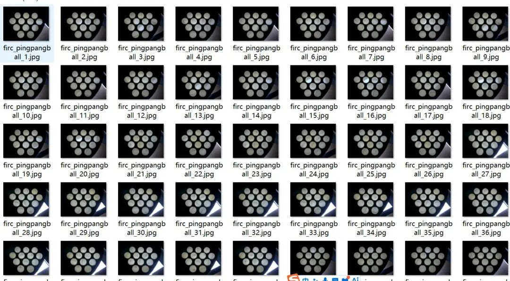
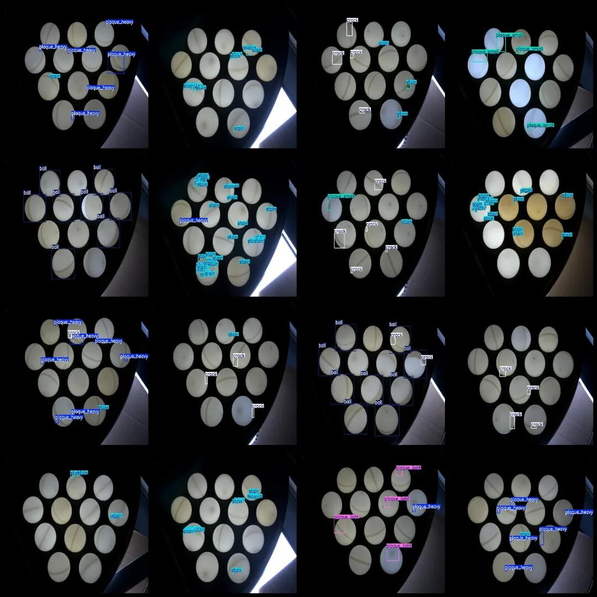
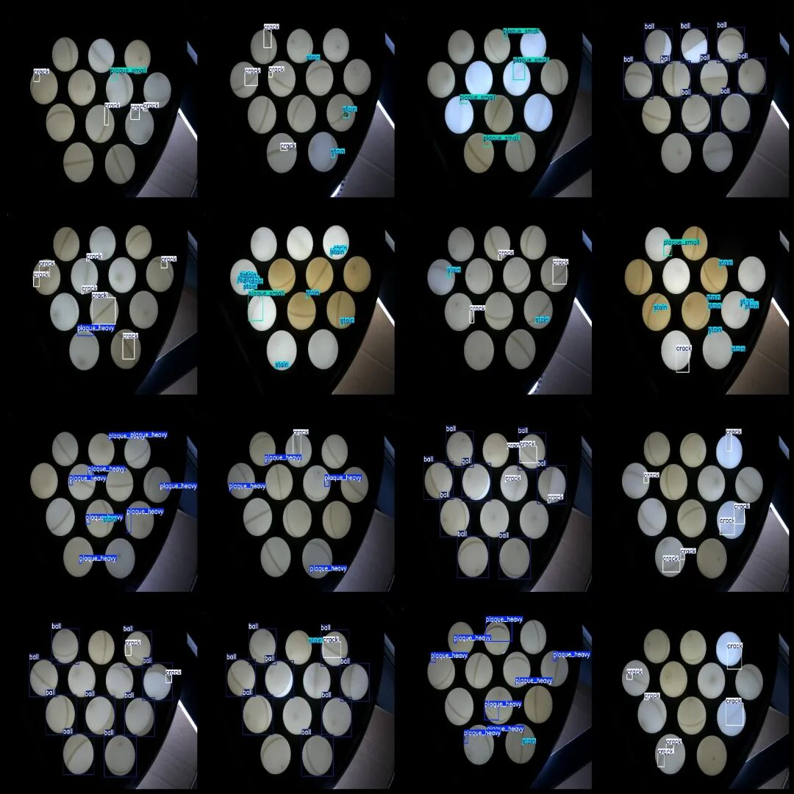

# Duoyu Table Tennis Pitching Detection Dataset VOC+YOLO format with 181 images in 6 categories

Dataset format: Pascal VOC format + YOLO format (txt file without split path, only containing jpg images and corresponding VOC format xml files and yolo format txt files)

Number of images (number of jpg files): 181

Number of annotations (number of xml files): 181

Number of annotations (number of txt files): 181

Label count: 6

Label category names (note that the order of yolo format categories does not correspond to this, but is based on the classes.txt in the labels folder): ["ball", "crack", "plaque_heavy", "plaque_light", "plaque_small", "stain"]

Number of boxes labeled in each category:

Ball (ball, to prevent misdetection, only mark a small part) frame count = 275, occupying picture count = 42.

Crack (cracks) frame count = 413, occupying picture count = 105

Plaque_heavy (Severe Plaque) frame count = 148, occupying picture count = 47

Plaque_light (mild plaque) frame count = 74, occupying picture count = 21

Plaque_small (small plaque) frame count = 103, occupying picture count = 34

Stain (stain) frame count = 659, occupying picture count = 92

Total frame count: 1672

Image resolution: 4024x3036

Using labelImg:

Annotation rules: Draw a rectangle around the category.

Important Notice: The dataset does not have separate training, validation, and test sets; you need to partition them yourself.

Special : This dataset does not guarantee the accuracy of the trained models or weight files.

Image Preview:

Annotation example:

## Payment

Here is a pay link on Stripe ( https://buy.stripe.com/3cs8yP7sY87d0vu9AB ). Please contact me lonlonago@foxmail.com after funding $89, and I will send you a complete data files , thank you!

